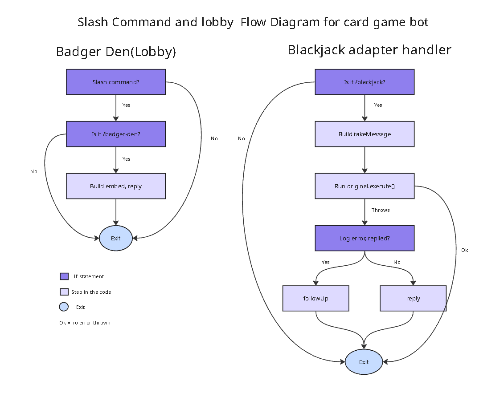

========== Harrison - class diagram of Deck and Card ==========

========== Juan - \[insert diagram name] ==========

========== Shiv - \[insert diagram name] ==========

========== Kevin - Slash commands and lobby (control-flow graph) ==========

## Interface Layer: Slash Commands and Badger Den

**Author:** Kevin

**Files:** `src/slashCommands.js`, `src/events/lobby.js`, `src/events/blackjackSlash.js`, `src/events/blackjack.js`

This layer is how users reach the bot. `src/slashCommands.js` registers two slash commands, `/badger-den` and `/blackjack`, with Discord for one server. `/badger-den` shows an embed that lists the available games. `/blackjack` starts the game by passing the interaction to the existing blackjack module, which was originally written for typed `!blackjack` messages.

### Figure 1: Control-Flow Graph of the Slash Command and Lobby Handlers

*Both listeners run on every interaction and exit early if the command isn't theirs. The blackjack listener adapts the slash command to the original prefix-based game.*

**Patterns**

- **Event-driven:** each handler is its own `interactionCreate` listener that returns early unless the command name matches.
- **Adapter:** the blackjack handler builds a `fakeMessage` with `author`, `content`, `channel`, and `reply`, so `blackjack.js` runs unchanged.

**How to add a new command**

1. Add a `SlashCommandBuilder` entry to the `commands` array in `src/slashCommands.js`.
2. Create an event file that returns early unless `commandName` matches.
3. Run `node src/slashCommands.js` (it replaces the server's registered commands, so keep every command in the array), then restart the bot.

**Known limitations**

- `original.execute()` returns once the game's message collector starts, so the adapter's `try/catch` only covers setup errors, not errors during later hit/stand turns.
- The Badger Den handler has no error handling.