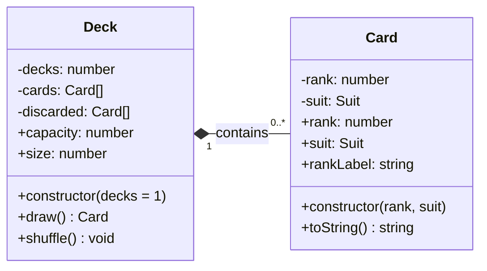

# Architecture

This document describes the main components of the Gracious Badger bot application and how they interact. Each section includes a short explanation and a diagram of the relevant design.

## Contents

- [Harrison - Card and Deck](#harrison--card-and-deck)
- [Juan - Diagram title](#juan--diagram-title)
- [Shiv - Diagram title](#shiv--diagram-title)
- [Kevin - Diagram title](#kevin--diagram-title)

---

## Harrison - Card and Deck

### Description

`Card` represents one playing card. Its private `rank` and `suit` fields are validated when the card is created; getters provide read-only access, and `toString()` produces a compact display label (such as `A♠`).

`Deck` creates 52 `Card` objects for each requested standard deck. It stores the available cards in a private array, supports in-place Fisher-Yates shuffling, and draws cards from the end of that array. The `capacity` getter reports the initial number of cards, while `size` reports how many remain. Drawing from an empty deck returns `undefined`.

### Class diagram

**Design notes:** `Deck` creates and manages its contained cards. `draw()` removes a card from the deck and returns it; the returned card can continue to exist independently. `Suit` is an exported constant object rather than a JavaScript class. `#discarded` is declared but not yet used.

---

## Juan - Diagram title

### Description

*Briefly describe the component(s)*

### Diagram

*Insert diagram here.*

---

## Shiv - Diagram title

### Description

*Briefly describe the component(s)*

### Diagram

*Insert diagram here.*

---

## Kevin - Diagram title

### Description

*Briefly describe the component(s)*

### Diagram

*Insert diagram here.*

---
